<h3><code>rashid@github ~ $ ./activity</code></h3>

  

<h3><code>rashid@github ~ $ whoami</code></h3>

  

IDEEN IN ANWENDUNGEN VERWANDELN.

 

Eigene SVG-Grafiken · Öffentliche GitHub-Daten · Tägliche Aktualisierung

