<picture>
  <source media="(max-width: 1100px) and (prefers-color-scheme: dark)" srcset="./terminal-mobile.svg" />
  <source media="(max-width: 1100px)" srcset="./terminal-mobile-light.svg" />
  <source media="(prefers-color-scheme: dark)" srcset="./terminal.svg" />
  
</picture>

<picture>
  <source media="(prefers-color-scheme: dark)" srcset="./stack.svg" />
  
</picture>

<a href="https://github.com/rashidbittar7-a11y?tab=overview"><picture>
  <source media="(prefers-color-scheme: dark)" srcset="./contributions.svg" />
  
</picture></a>
